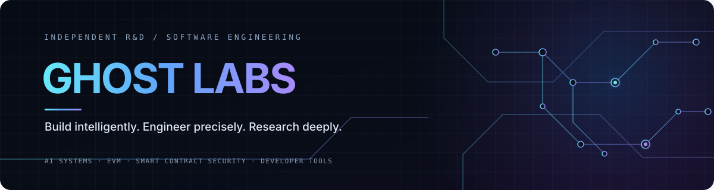

  

  <strong>Genadi Avetisov</strong> · Founder, <a href="https://ghost-labs.store/">Ghost Labs</a> 
  Software Engineering · AI Systems · Smart Contracts · Web3 Security

  <a href="https://ghost-labs.store/">Website</a> ·
  <a href="https://www.linkedin.com/company/ghostlabs-inc">Ghost Labs on LinkedIn</a> ·
  <a href="https://www.linkedin.com/in/genadi-avetisov/">Founder on LinkedIn</a> ·
  <a href="https://x.com/GhostLabsOS">X</a> ·
  <a href="https://reddit.com/user/Ghost--Labs/">Reddit</a> 
  <a href="https://t.me/GhostLabsHQ">Telegram Channel</a> ·
  <a href="https://t.me/GhostLabsCommunity">Telegram Community</a> ·
  <a href="https://github.com/GhostLabs-dot">GitHub Organization</a>

---

## About

I'm the founder of Ghost Labs, an independent R&D and software engineering studio. I build software and AI products, engineer smart-contract systems, and work on the tools and testing methods used to understand complex software behaviour.

The work spans product engineering, applied AI, EVM systems, security assessments, and developer tooling. I don't tie a project to one language or framework; architecture and tooling follow the problem, its constraints, and the evidence needed to validate the result.

## What I work on

<table>
  <tr>
    <td width="50%" valign="top">
      <strong>Software &amp; AI Systems</strong> 
      End-to-end product engineering, backend systems and APIs, integrations, workflow automation, and AI-powered applications.
    </td>
    <td width="50%" valign="top">
      <strong>Smart Contracts &amp; EVM</strong> 
      Solidity engineering, blockchain integrations, transaction behaviour, execution analysis, and state inspection.
    </td>
  </tr>
  <tr>
    <td width="50%" valign="top">
      <strong>Smart Contract Security</strong> 
      Scoped reviews and audits, threat modelling, stateful and invariant-oriented testing, fuzzing, trace investigation, replay, and remediation guidance.
    </td>
    <td width="50%" valign="top">
      <strong>Developer Tools &amp; R&amp;D</strong> 
      Testing infrastructure, compiler evidence, instrumentation, reproducible experiments, and engineering tools that make system behaviour easier to inspect.
    </td>
  </tr>
</table>

## Featured open-source project

### [EVMTraceX — EVM Execution Trace Explorer](https://github.com/GhostLabs-dot/EVMTraceX)

An interactive, terminal-first explorer for supported EVM execution traces. EVMTraceX helps developers and security researchers inspect nested calls, gas usage, function selectors, reverts, errors, and storage changes without losing the structure of the execution.

- Supports Geth-style `callTracer` JSON and Foundry traces.
- Includes filters for reverted frames and frames with storage changes.
- Works locally by default; RPC tracing is used only when explicitly configured.

**[Explore EVMTraceX on GitHub →](https://github.com/GhostLabs-dot/EVMTraceX)**

## In development

A few things I'm building at Ghost Labs are being prepared for public release. More details and repositories will be published when each project is ready.

**Ghost Labs AI Studio**  
An end-to-end AI creative production workflow, from structured planning through generation and final output. The public release is in preparation.

**CodegenX**  
Compiler-optimization intelligence that turns compiler evidence into traceable findings, baseline comparisons, and structured reports. The public release is in preparation.

**Trace2POC**  
A tool for reconstructing real EVM transaction evidence into reproducible Foundry replay tests and verification artifacts. The public release is in preparation.

## Proprietary smart-contract fuzzing R&D

A major internal research effort at Ghost Labs is a smart-contract fuzzing engine built in-house. Its exploration combines execution-coverage signals and mutation feedback with reinforcement-learning methods, including actor–critic/PPO policy learning, RND-style novelty signals, and stateful transaction-sequence search.

The engine is used internally as part of controlled security testing and remains private; it is not a public release. Promising signals are treated as candidates for investigation, with reproduction and validation used where feasible—not as automatic proof that a vulnerability exists.

## How I approach engineering

- **Evidence before claims.** Findings should be traceable to observable behaviour, not just plausible explanations.
- **Reproducibility matters.** Tests and replay should make it possible to check what happened and under which assumptions.
- **Scope and limits stay explicit.** Every assessment has boundaries; no single tool or test strategy can guarantee that a system has no vulnerabilities.
- **The problem comes first.** Language and framework choices follow the system's performance, reliability, security, and integration needs.

## Connect

For company news, new public tools, and release announcements, follow the official Ghost Labs channels.

  <a href="https://ghost-labs.store/">ghost-labs.store</a> ·
  <a href="https://www.linkedin.com/company/ghostlabs-inc">LinkedIn</a> ·
  <a href="https://x.com/GhostLabsOS">X</a> ·
  <a href="https://reddit.com/user/Ghost--Labs/">Reddit</a> 
  <a href="https://t.me/GhostLabsHQ">Telegram Channel — Announcements</a> ·
  <a href="https://t.me/GhostLabsCommunity">Telegram Community — Group Chat</a>

  Build intelligently. Engineer precisely. Research deeply.

